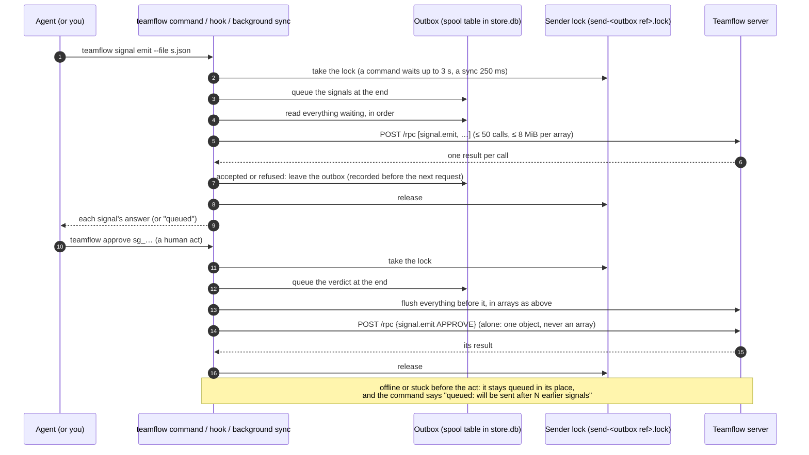
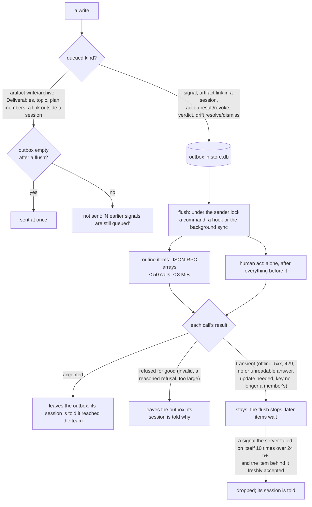

# How it works

## What it sends, and where

The client talks to one place only: the Teamflow server you sign in to, over HTTPS (`/rpc`, JSON-RPC) and a
WebSocket (`/live`). It sends nothing to anyone else: no telemetry, no analytics, no crash reports.

What goes to that server:

- **Signing in:** your email and password, once; the server answers with an account key.
- **On every call:** your key in the `Authorization` header, and a `Teamflow-Client` header with this client's
  name, version and protocol number.
- **What you and your agents record:** signals (decisions, key points, comments, results), topics, artifacts
  (only the files an agent or you choose to publish), deliverables and their updates, and your approvals or
  rejections (marked when given through your agent). Each carries the agent session id it came from.
- **Keeping up to date:** your position (cursor) in each project's event log, to fetch what changed. The background
  sync asks for a short-lived live ticket (`live.ticket`, with the project key in the `Authorization` header), opens
  `wss://<server>/live?org=<id>&project=<id>` (ids only: no key or ticket in the URL; the socket carries no
  `Authorization`), sends the ticket and its cursor as its first message, then `ping` every 10 seconds.

What stays on your machine:

- Your prompts and code.
- Your keys and the local copy of your projects, in `~/.teamflow` (or `$TEAMFLOW_HOME`): the folder is mode 0700
  and its files 0600 (`config.json` holds the server, your email and the auth key; `store.db` the rest). Keys never appear in command lines, logs or URLs.

## The background sync

`teamflow sync` keeps the local copy live, so hooks and commands answer from it without waiting on the network.
One copy runs per machine (`sync.lock`, an `flock` in the Teamflow home): install starts it, and so does each
session start and prompt hook when it is not running (after a reboot, a restart or its quiet exit). It exits after
10 minutes with no active agent session (none seen, and no agent process of a recent session alive), and at once
when you sign out. `teamflow sync --status` says whether it runs and which projects are live; `teamflow sync
--stop` stops it; `teamflow sync --background` starts it detached, its output appended to `sync.log` (0600) in the
Teamflow home. `sync` is a setup command: an agent never runs it without your say.

- **One socket per project** you hold a key for (the protocol in the server's `tf_models/live.py`): each event is
  written into the local copy as it commits, with its cursor, in one transaction, and turned into notices: an
  approval request reaches your session at its next step within seconds. An event already applied (a command's
  pull brought it first, or it is sent again) is not applied twice; gaps in the event numbers are normal.
- **Freshness.** While a project's socket is live (something heard from it, a pong or an event, within 15 seconds),
  hooks and commands do not pull it over the network, except a command looking up a signal or artifact the local
  copy does not have yet (just written, or still on its way over the socket), which pulls for it; when it is not
  live, they pull as before (`HOOK_TIMEOUT`, 4 s).
  Only what is heard moves that time, and it is cleared the moment a socket ends, so a socket that stops answering
  is never trusted longer than 15 seconds.
- **Reconnecting.** Once live it pings every 10 seconds (the server answers without waking); nothing heard within 5
  seconds of a ping means the socket is dead, and a new one opens at once with a fresh ticket from the cursor. A failed connect waits 1, 2, 3, 5, 8,
  13 seconds; after 3 in a row (WebSockets blocked) it polls `sync.poll` (wait 25 s) and tries the socket again
  every 60 seconds. A server with live sync off refuses the ticket (`use sync.poll`): that is a failed connect, so
  it polls, and keeps the key (only a refusal of `sync.poll` itself, or `NOT_A_MEMBER`, drops it). The server closing with `TOO_SLOW` reconnects at once; `REPLACED` (a newer socket of yours on
  the project) stops that project's socket for good; `NOT_A_MEMBER` drops the project's key and its socket stays
  closed; a reset (a restored server) drops the project's local copy and fetches it again from the start.
- **The outbox.** It sends what waits in the outbox through the same sync, under the same sender lock as commands
  and hooks, so it never sends beside them; an outbox it left items in is tried again after a wait (growing
  while nothing moves), which also gives a waiting command its turn.
- **Its log** names projects and reasons, never a ticket or a key (a server's message naming one is masked).

## How signals are sent

Everything this machine records on a project's shared record leaves in the order it was made: one ordered outbox
per project and sign-in, one sender at a time.





Plain text, for viewers without Mermaid:

```
agent / you ──> teamflow <cmd> ──> outbox (store.db, per sign-in and project, in order)
                                     │
               flush points: the command that queued it; human acts and other writes;
                             later commands, agent hooks, the background sync (a sync flushes before it pulls)
                                     │  one sender at a time: send-<outbox ref>.lock (flock) in the Teamflow home
                                     ▼
             routine items ──> [call, call, …] ≤ 50 calls, ≤ 8 MiB ──> server ──> one result per call
             human act     ──> flush everything before it, then {one call}, alone
                                     │
               accepted ─────────> leaves; its session hears "reached the team"
               refused for good ─> leaves; its session hears why
               transient ────────> stays; the flush stops; everything after it waits
                                   (a signal failed on itself 10 times over ≥ 24 h, the item behind it
                                    freshly accepted: dropped, its session told)
```

In detail:

- **The outbox.** Signals an agent records (`signal emit`, `action result`, `action revoke`, `artifact link` inside
  its session) and human acts (`approve`, `reject`, `drift resolve`, `drift dismiss`) are queued in the `spool`
  table of `store.db`, in the outbox of the project under your sign-in (server and account), and sent from there
  in order, under whatever key that sign-in holds for the project when they go. A queued item survives a restart,
  a reboot, a killed process, a logout and login as the same account, and a project key dropped and fetched
  again; an act made offline with no key for the project is queued all the same. Another account signing in on
  this machine never sends your items: they stay, and `teamflow status` and `teamflow outbox` show them.
- **Flush points.** The command that queued an item flushes at once; so do human acts and writes that are not
  queued. Later commands and the agent hooks sync the project (inside an agent's turn at most once every 10 s, and
  not for 30 s after the server was unreachable), the background sync sends what waits, and a sync flushes the
  outbox before it pulls, within the sync's
  own time limit (a hook's few seconds): what does not fit waits for the next one. A sync also fetches a new key
  for a project whose items wait but whose key was dropped; when the server refuses the membership, it asks again
  only after 10 minutes, not on every command and hook.
- **Batches.** Routine items go as one JSON-RPC array per request, packed by count (at most 50) and size (at most
  8 MiB). Each request's results are recorded before the next request goes out, so a crash between requests
  resends nothing already answered.
- **Human acts go alone.** A verdict or drift act is queued at the end, then the flush sends everything before it
  (in arrays), then the act as a single call, never inside an array. If the flush stops before the act (offline,
  a stuck item, another sender busy), the act waits in its place and is never sent ahead: the command exits 0 and
  says `queued: will be sent after N earlier signals` (`--json`: `"queued": true, "ahead": N`). It is sent alone,
  in order, by a later flush. When the stop needs you (`update teamflow`, a key no longer a member's), the command
  fails with that reason, and the act still waits in the outbox. When another `teamflow` holds the sender lock,
  the act is handed to it (`handed to the outbox: … sends it in its turn`): it may already be sent when the
  command answers. What became of an act made outside any agent session (a refusal later, say) is shown on your
  next `teamflow` command.
- **Writes that are not queued** (artifact write and archive, Deliverables, topic, plan and member changes, a link
  published outside an agent session) flush the outbox first and are sent only when it is empty. Otherwise they
  are not sent: `not sent: N earlier signals are still queued …; try again once they are sent`. When another
  `teamflow` holds the sender lock past the wait and nothing is queued, they are sent (nothing to overtake).
- **One sender at a time.** A flush holds a lock file in the Teamflow home (`send-<outbox ref>.lock`, `flock`), so
  commands, hooks and the background sync in different processes never interleave. A sync waits 250 ms for it, a command sending its
  own items 3 s; past that it leaves its items queued for the holder (which reads the outbox again before it
  lets go) or the next flush. The kernel drops the lock when its holder exits, even when killed, so a crashed
  holder never blocks the outbox.
- **Errors keep the order.** A transient error (the server unreachable, a 5xx, a 429, a call with no answer or an
  answer this client can't read, `UPGRADE_REQUIRED`, a key that is no longer a member's) stops the flush there:
  that item and everything after it wait. A permanent refusal (invalid params, a refusal with a reason such as a
  stale version, a call over 8 MiB, an item that can't be read) drops only that item, tells the session that made
  it why, and the flush goes on. Within one array the server has already handled the calls after a transient
  one; their results are kept.
- **A stuck signal is given up on.** A signal the server keeps failing on (no answer for it, an answer this
  client can't read, an internal error, an HTTP 500) would hold everything after it back. A failure counts only
  when it is the item's own: it went alone, or other calls in its request were answered (an unreadable answer
  inside a batch never counts). When a whole request fails, or every call in it, nothing counts and the head goes
  alone next time. Once a signal has 10 counted failures spanning at least 24 hours, the item right behind it is
  sent: if the server freshly accepts it (never sent before, so not the stored answer to an earlier send), the
  server stores again and the signal is the problem, so it is dropped and its session is told (record it again if
  it still matters). If that one is refused, answered from an earlier send, or fails the same way (a part of the
  server is down), the stuck signal stays; a refused item leaves the outbox, and the next one is tried next time. A signal with nothing queued behind it is never dropped. An
  outage (no connection, a timeout, 502, 503, 504, 429), `UPGRADE_REQUIRED` and a key that is no longer a
  member's never count, however long they last. A human act (a verdict, a drift act) is never dropped this way:
  only you drop it, with `teamflow outbox drop`.
- **`teamflow outbox`** lists everything waiting (every sign-in's): id, method, project, sign-in, age, tries and
  failures. `teamflow outbox drop <id>` takes one out after a confirmation (or `--yes`): it is never sent. It is a
  setup command, never allowed to an agent without asking you.
- **Order is best-effort when a single call fails.** The server numbers calls as they arrive: a call whose answer
  is lost and that goes again later (or the item sent behind a stuck signal, when that signal then goes through)
  can be numbered after an item queued behind it. Strict order across clients is a later design item.
- **Retries are idempotent.** A resend carries the same signal ids, and the server answers a signal id it has
  seen with its first result, so nothing is recorded twice. A drift act has no id the server keeps: resent after
  a lost answer, the server refuses it as it refuses any act on a closed drift (`DRIFT_CLOSED` for a resolve,
  `NOT_ALLOWED` for a dismiss). The client then pulls and looks: if the drift is closed with this act's status and
  note (and, when a resolve named signals in `--resolved-by`, those signals; the server fills in the drift's own
  otherwise), the first send took and the session hears it reached the team; otherwise the refusal stands.
- **Offline.** Hooks work from the local replica; signals and human acts wait in the outbox; nothing is lost.
