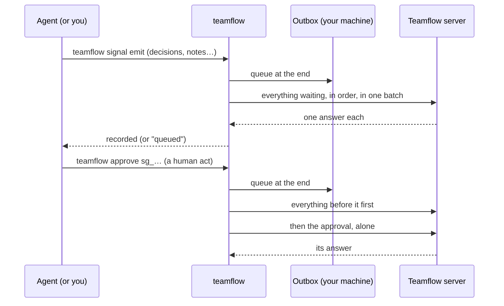

# How it works

## When your agent records something

1. Your agent (or you) runs a `teamflow` command, for example `teamflow signal emit` for a decision.
2. The command puts it in a small **outbox** on your machine (`~/.teamflow/store.db`) and sends it straight away.
3. The **Teamflow server** you signed in to keeps it on the project's shared record.
4. Your **teammates** see it: their background sync hears it within seconds, and it is in the
   [web app](https://teamflow.10l.ink/ui/).

Everything you record on a project leaves in the order it was made: one outbox per project and sign-in, one
sender at a time. Routine items travel together; a human act (an approval, a rejection, a drift resolved or
dismissed) waits for everything before it, then goes on its own.

## Approvals reach the approver at once

When a decision needs someone's approval, the server tells their background sync over a live connection. The
request reaches their agent session at its next step, within seconds, and `teamflow team approvals` (or the web
app) lists it. They approve or reject in their session, a terminal or the web app.

## What runs in the background

`teamflow sync` keeps a local copy of your projects up to date, so your agent's hooks and commands answer from it
without waiting on the network. One copy runs per machine. `teamflow install` starts it, and your agent's session
start and prompts start it again when it isn't running (after a reboot, say). It stops by itself after 10
minutes with no active agent session, and when you sign out.

- `teamflow sync --status`: whether it runs, and which projects are live.
- `teamflow sync --stop`: stop it.

It also sends whatever is still waiting in the outbox, and keeps `teamflow` up to date: about once a day it asks
GitHub whether a newer release exists and, if so, installs it after checking its signature (never an older one or a
pre-release), then restarts on it and tells your sessions. `teamflow config auto-update off` stops that;
`/teamf upgrade` or `teamflow self-update` then updates by hand.

## Offline

Your agent keeps working from the local copy, and what it records waits in the outbox, in order. It is sent when
the server is back; nothing is lost (`teamflow outbox` shows what waits).

## What is sent, and where

Only to the Teamflow server you sign in to, over HTTPS and a WebSocket. Nothing goes to anyone else: no
telemetry, no analytics, no crash reports. The one exception is GitHub, for updates: about once a day the background
sync asks GitHub's API for teamflow's latest release and downloads it when it is newer (as `/teamf upgrade` and
`teamflow self-update` do when you run them). That request carries nothing about you or your projects: only the
address every client asks and a fixed user agent (GitHub sees your network's address, as with any download).
`teamflow config auto-update off` stops it.

- **Signing in:** your email and password, once; the server answers with a key.
- **Every call:** that key, and this client's name, version and protocol number.
- **What you and your agents record:** decisions and other signals, topics, the files you or your agent choose to
  publish, deliverables and their updates, and your approvals and rejections. Each names the agent session it
  came from.
- **Keeping up to date:** where you are in each project's history, to fetch what changed.

## What never leaves your machine

- Your prompts and your code (only what you or your agent choose to record or publish is sent).
- Your password (used once to sign in, never kept).
- Your keys and the local copy of your projects, in `~/.teamflow` (or `$TEAMFLOW_HOME`): the folder is private to
  you (mode 0700, files 0600), and keys never appear in command lines, logs or URLs.
